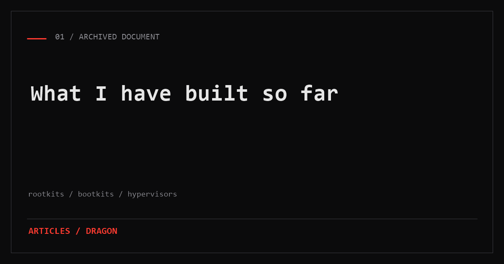
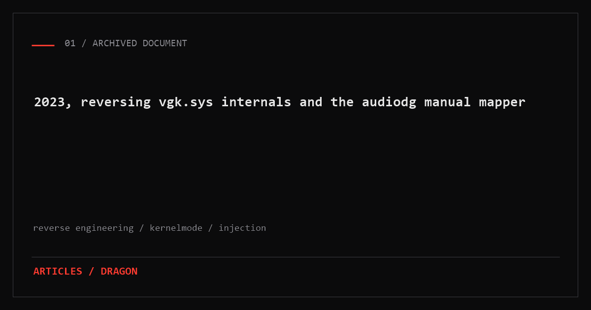

<div align="center">


# dragon

<p>
  <a href="https://3eed.page.gd"></a>
  &nbsp;
  <a href="https://discord.com/users/1330197919797743617"></a>
  &nbsp;
  <a href="https://bsky.app/profile/riotemployee.bsky.social"></a>
</p>

</div>

---

### about

I work close to the metal. Most of what I write ends up somewhere below the level where most software is comfortable: boot firmware, kernel drivers, hypervisor entry code, and the reversing that comes before any of it.

I have been at it since 2018. The languages I actually use are `c`, `c++`, `c#`, `asm`, `python`, `bash`. The platforms I target are `windows`, `linux`, and the privilege level I care about is **ring 0 and below**.

This site is the written part of that work. Anything I post is either something I have taken apart properly or something I got wrong and corrected.

---

### works in

```
reverse engineering  /  assembly  /  rootkits  /  bootkits (uefi)  /  hypervisors  /  game cheats
```

---

### articles

<a href="https://3eed.page.gd/article.php?slug=2026-10-10-what-i-have-built">
  
</a>

<br/><br/>

<a href="https://3eed.page.gd/article.php?slug=2026-10-12-reversing-vanguard-audiodg-injection">
  
</a>

---

<div align="center">
<sub>&copy; 2026 dragon &bull; <a href="https://3eed.page.gd">3eed.page.gd</a></sub>
</div>
